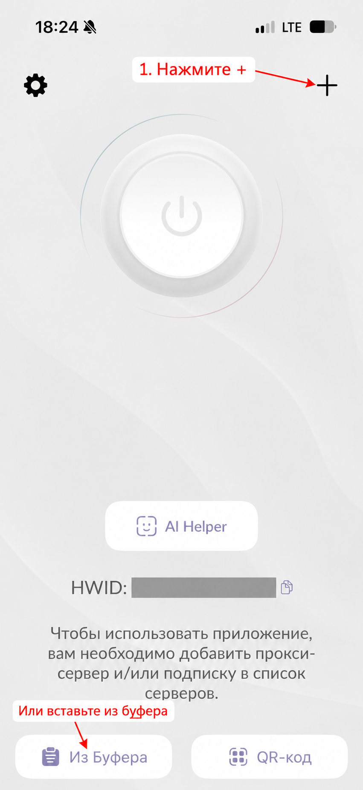
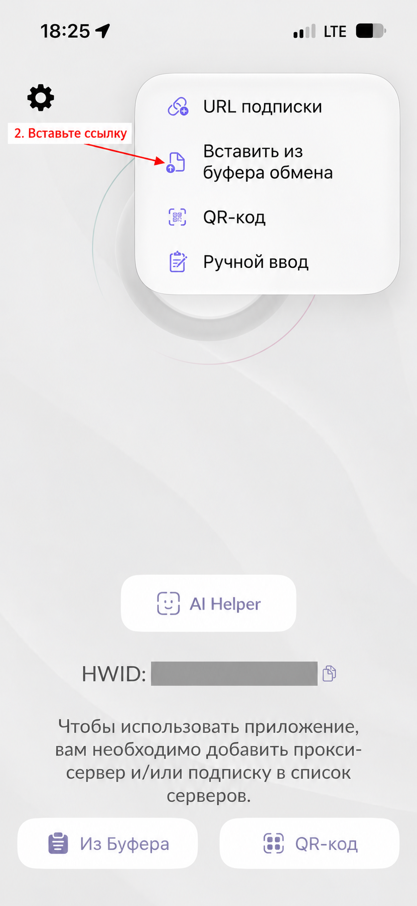
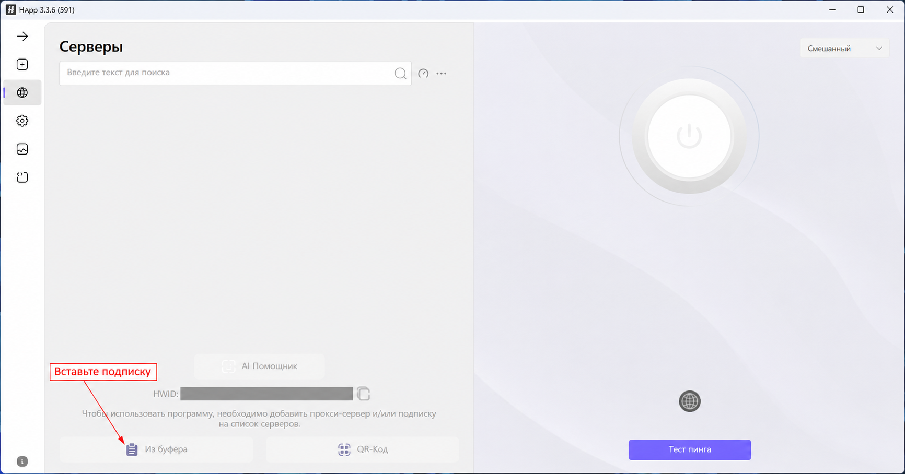
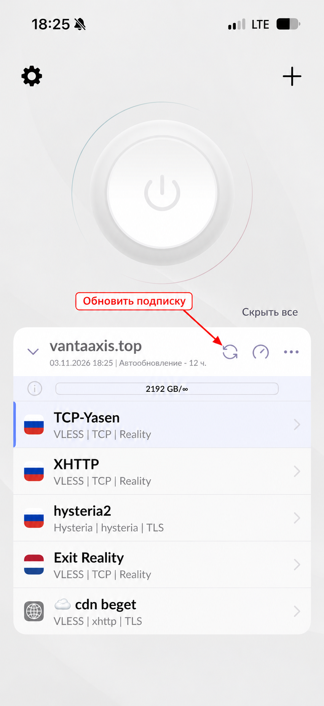
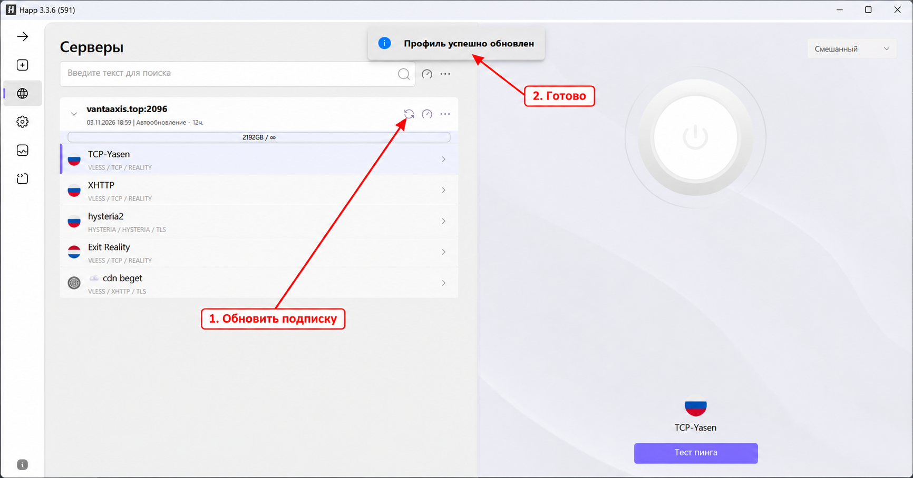
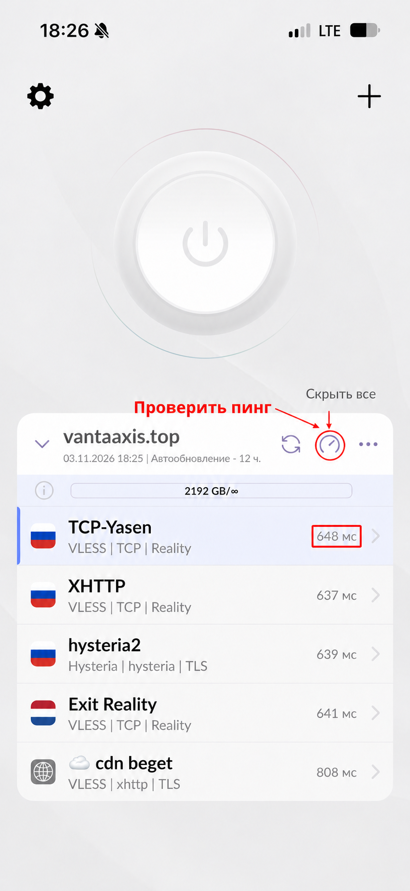
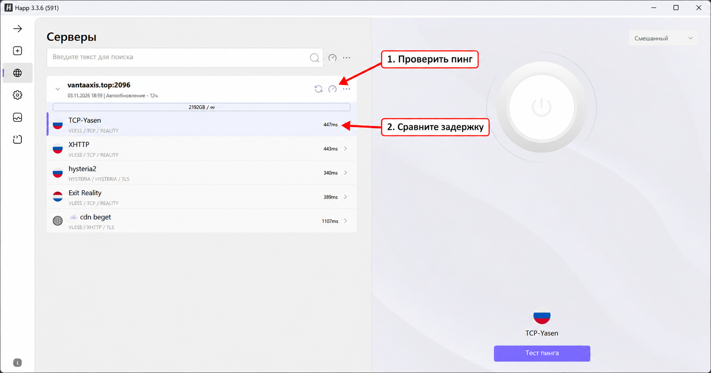
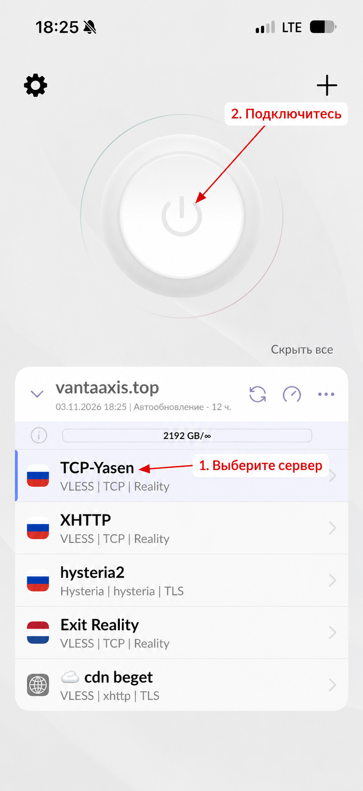
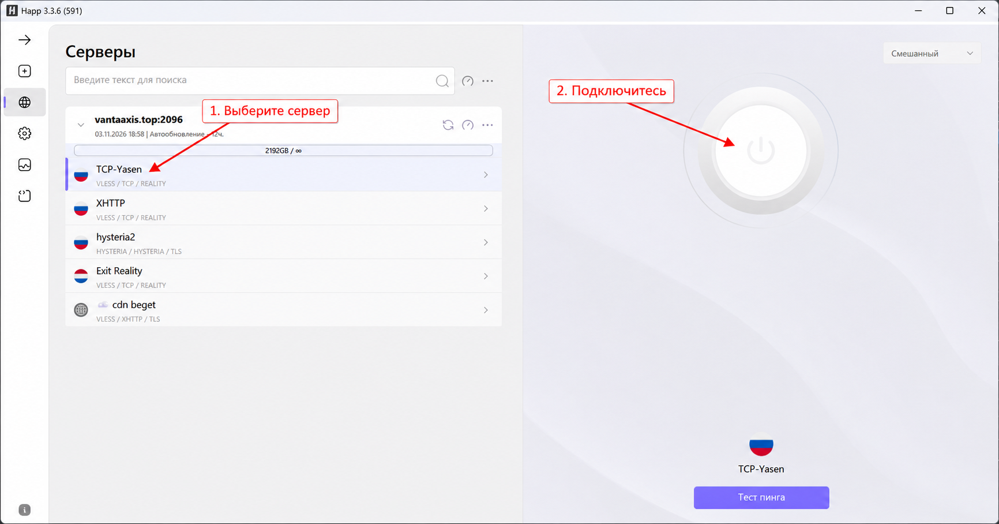

# Happ: подключение и использование

<!-- *** [2026, 3 ноября, 19:09:31]: инструкция сокращена до общих действий, добавлены скриншоты телефона и компьютера. -->
<!-- ** [2026, 3 ноября, 19:13:30]: добавлены размеченные скриншоты с первого запуска, изображения показаны без сворачивания. -->
<!-- * [2026, 3 ноября, 19:33:14]: запуск перенесён после обновления, проверки пинга и выбора подключения. -->
[← К списку инструкций](../README.md)

<!-- * [2026, 4 ноября, 15:57:26]: вводное описание приведено к нейтральной формулировке. -->
Happ — приложение для подключения к сервису VantaAxis. Установите его с [официального сайта](https://happ.info/), выбрав версию для своего устройства.

Действия на телефоне и компьютере похожи; расположение кнопок может немного отличаться. Названия серверов на скриншотах приведены для примера — ваш список может отличаться.

<!-- * [2026, 3 ноября, 19:40:24]: добавлена ссылка на обновление для пользователей с уже добавленной подпиской. -->
> **Подписка уже добавлена в Happ? [Переходите сразу к пункту 2 — обновлению подписки](#2-обновите-подписку).**

## 1. Добавьте подписку

1. Скопируйте персональную ссылку на подписку, полученную от сервиса.
2. Откройте Happ и нажмите **«Из буфера»**. На телефоне также можно нажать **«+» → «Вставить из буфера обмена»**.
3. Дождитесь появления списка серверов.

> Не передавайте другим свою ссылку на подписку и QR-код.

**Добавление подписки на телефоне:** нажмите «+», затем «Вставить из буфера обмена». Кнопка «Из Буфера» на начальном экране позволяет сделать это сразу.

**Добавление подписки на компьютере:** нажмите «Из буфера».

## 2. Обновите подписку

Нажмите **значок круговых стрелок рядом с названием подписки** и дождитесь завершения. На телефоне появится зелёная галочка, на компьютере — сообщение **«Профиль успешно обновлен»**.

После обновления проверьте список. Новые подключения появятся, если сервис добавил их в вашу подписку.

**Удалять и заново добавлять подписку не нужно.** Обновление загружает актуальный список, но не продлевает срок подписки.

**Телефон:** стрелка указывает на обновление подписки.

**Компьютер:** кнопка обновления и сообщение о результате.

## 3. Проверьте пинг и выберите сервер

Нажмите **значок спидометра рядом с названием подписки**, чтобы проверить задержку серверов в группе. Дождитесь чисел рядом с подключениями.

<!-- * [2026, 3 ноября, 19:36:39]: выделена рекомендация выбирать подходящий сервер с наименьшим пингом. -->
Пинг измеряется в миллисекундах: меньшее значение обычно означает меньшую задержку. **Рекомендуем выбирать сервер с наименьшим пингом среди подходящих вам подключений**, учитывая рекомендации ниже.

**Низкий пинг не гарантирует высокую скорость.** Сравните несколько серверов в своей сети. Для проверки скорости используйте один и тот же тест; на мобильном интернете он расходует трафик.

<!-- * [2026, 3 ноября, 19:26:10]: уточнены назначения подключений по флагам и исключён выбор исходящего Exit Reality. -->
> **Какое подключение выбрать:**
> - 🇷🇺 Подключения с флагом России **не обходят белые списки**.
> - Для обхода белых списков используйте дополнительные подключения **ниже строки с флагом Нидерландов**, например **cdn beget**. Новые варианты будут добавляться туда же.
> - 🇳🇱 **Само подключение Exit Reality не выбирайте вообще:** это служебное исходящее подключение, напрямую оно не работает.

**Телефон:** запустите проверку и сравните значения справа от серверов.

**Компьютер:** значок спидометра проверяет серверы подписки.

## 4. Включите подключение

Когда подписка обновлена и сервер выбран:

1. Нажмите на строку нужного сервера, затем на большую кнопку включения.
<!-- * [2026, 4 ноября, 15:57:26]: уточнена формулировка системного разрешения. -->
2. Если система запросит разрешение на создание подключения, подтвердите его.
3. Откройте несколько сайтов и проверьте, что они загружаются.

Для отключения нажмите кнопку включения ещё раз. Чтобы сменить сервер, отключитесь, выберите другой и подключитесь снова.

**Выбор сервера и подключение:** сначала выберите строку сервера, затем нажмите большую кнопку включения.

## Если что-то не работает

<!-- * [2026, 4 ноября, 15:57:26]: рекомендации описаны через подключение в Happ и другие приложения. -->
| Проблема | Что сделать |
| --- | --- |
| Подписка не обновляется или список пуст | Проверьте интернет при отключённом Happ и актуальность ссылки. Попробуйте другую сеть. |
| Новые серверы не появились | Обновите нужную подписку. Если обновление прошло успешно, уточните у поддержки, добавлены ли подключения в вашу подписку. |
| Не подключается или сайты не открываются | Проверьте интернет при отключённом Happ, отключите другое приложение для подключения, обновите подписку и попробуйте другой сервер. |
| Один сервер перестал работать | Переключитесь на другой. Если остальные работают, сообщите поддержке название проблемного сервера. |

Если проблема осталась, отправьте поддержке модель устройства, версию Happ, тип сети и текст ошибки. На скриншоте закройте ссылку подписки, QR-код и другие персональные данные.
