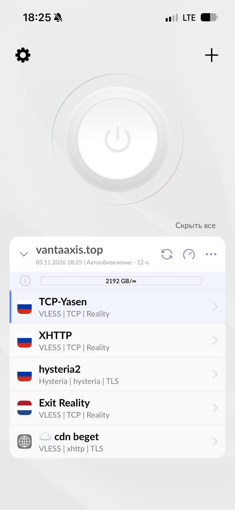
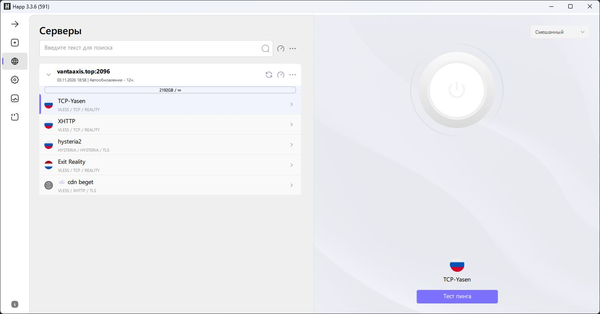
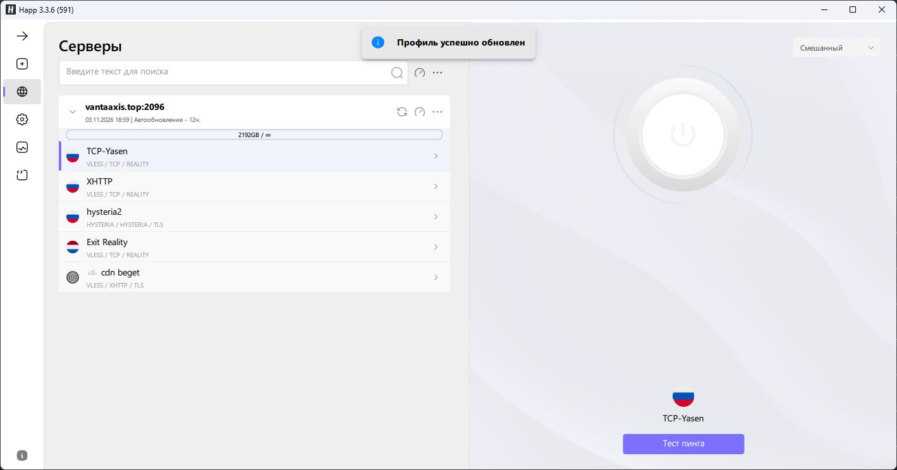
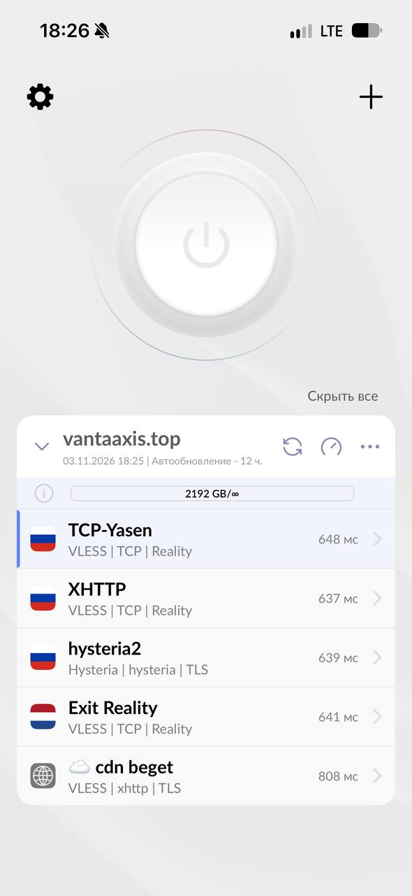

# Happ: подключение и использование

<!-- *** [2026, 3 ноября, 18:39:54]: подготовлен черновик инструкции. -->
<!-- ** [2026, 3 ноября, 18:44:21]: инструкция перенесена в docs, добавлена ссылка на главную страницу. -->
<!-- * [2026, 3 ноября, 19:09:31]: инструкция сокращена до общих действий, добавлены скриншоты телефона и компьютера. -->
[← К списку инструкций](../README.md)

Happ — приложение для подключения к нашему VPN-сервису. Установите его с [официального сайта](https://happ.info/), выбрав версию для своего устройства.

Действия на телефоне и компьютере похожи; расположение кнопок может немного отличаться. Названия серверов на скриншотах приведены для примера — ваш список может отличаться.

## 1. Добавьте подписку и подключитесь

1. Скопируйте персональную ссылку на подписку, полученную от сервиса.
2. Откройте Happ и нажмите **«Из буфера»**. Если подписка уже добавлена, переходите к следующему разделу. На телефоне также можно нажать **«+» → «Вставить из буфера обмена»**.
3. Дождитесь появления списка серверов и нажмите на нужный сервер.
4. Нажмите большую кнопку включения. Если система запросит разрешение на VPN-подключение, подтвердите его.
5. Откройте несколько сайтов и проверьте, что они загружаются. Для отключения нажмите кнопку включения ещё раз.

> Не передавайте другим свою ссылку на подписку и QR-код.

Показать список серверов на телефоне и компьютере

**Телефон** — выбранный сервер выделен цветной полосой слева; большая кнопка сверху включает подключение.

**Компьютер** — список слева, кнопка подключения справа.

## 2. Обновите подписку

Нажмите **значок круговых стрелок рядом с названием подписки** и дождитесь завершения. На телефоне появится зелёная галочка, на компьютере — сообщение **«Профиль успешно обновлен»**.

После обновления проверьте список и выберите сервер. Новые подключения появятся, если сервис добавил их в вашу подписку.

**Удалять и заново добавлять подписку не нужно.** Обновление загружает актуальный список, но не продлевает срок подписки.

Показать успешное обновление

**Телефон**

**Компьютер**

## 3. Проверьте пинг и выберите сервер

Нажмите **значок спидометра рядом с названием подписки**, чтобы проверить задержку серверов в группе. Дождитесь чисел рядом с подключениями.

Пинг измеряется в миллисекундах: меньшее значение обычно означает меньшую задержку. Выберите доступный сервер с небольшим пингом и проверьте сайты или видео. Чтобы сменить сервер, отключитесь, выберите другой и подключитесь снова.

**Низкий пинг не гарантирует высокую скорость.** Сравните несколько серверов в своей сети. Для проверки скорости используйте один и тот же тест; на мобильном интернете он расходует трафик.

Показать результаты проверки пинга

**Телефон**

**Компьютер**

## Если что-то не работает

| Проблема | Что сделать |
| --- | --- |
| Подписка не обновляется или список пуст | Проверьте интернет без VPN и актуальность ссылки. Попробуйте другую сеть. |
| Новые серверы не появились | Обновите нужную подписку. Если обновление прошло успешно, уточните у поддержки, добавлены ли подключения в вашу подписку. |
| Не подключается или сайты не открываются | Проверьте интернет без VPN, отключите другое VPN-приложение, обновите подписку и попробуйте другой сервер. |
| Один сервер перестал работать | Переключитесь на другой. Если остальные работают, сообщите поддержке название проблемного сервера. |

Если проблема осталась, отправьте поддержке модель устройства, версию Happ, тип сети и текст ошибки. На скриншоте закройте ссылку подписки, QR-код и другие персональные данные.
